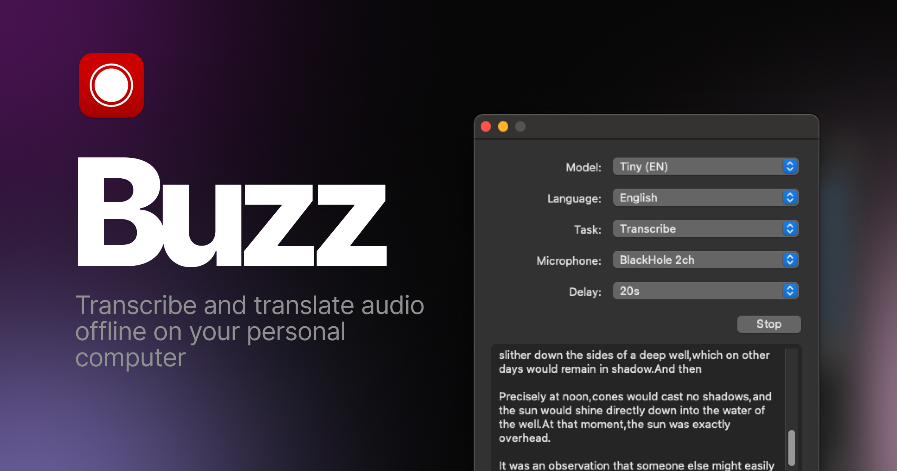
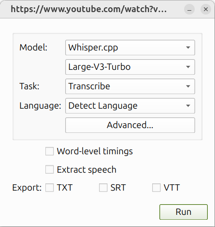
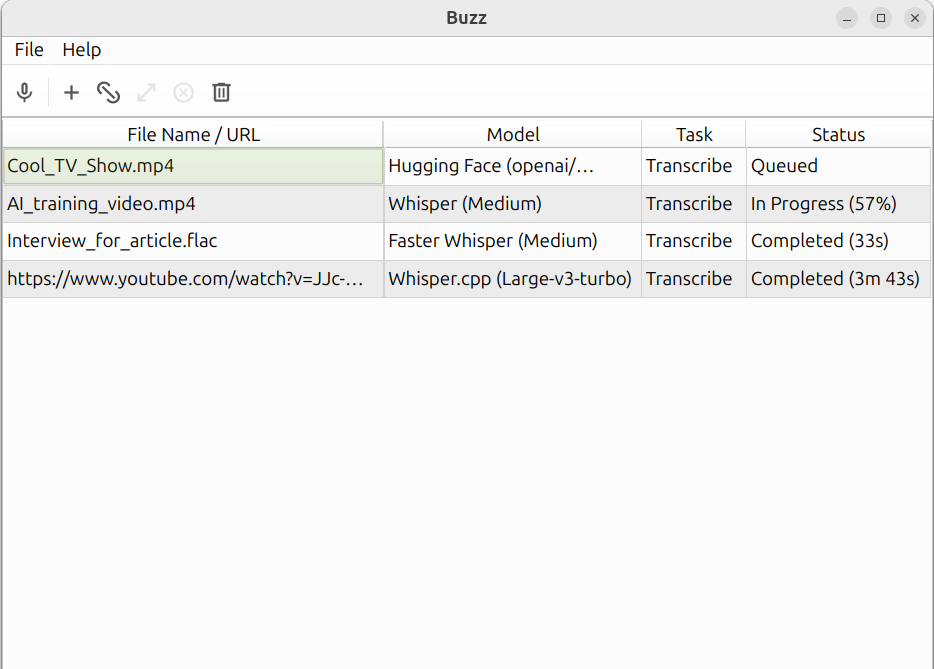
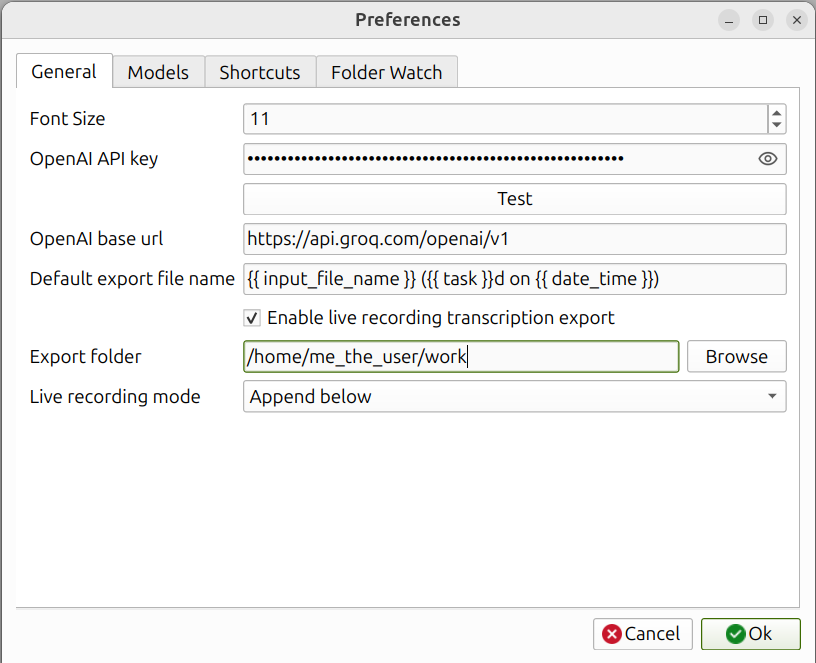
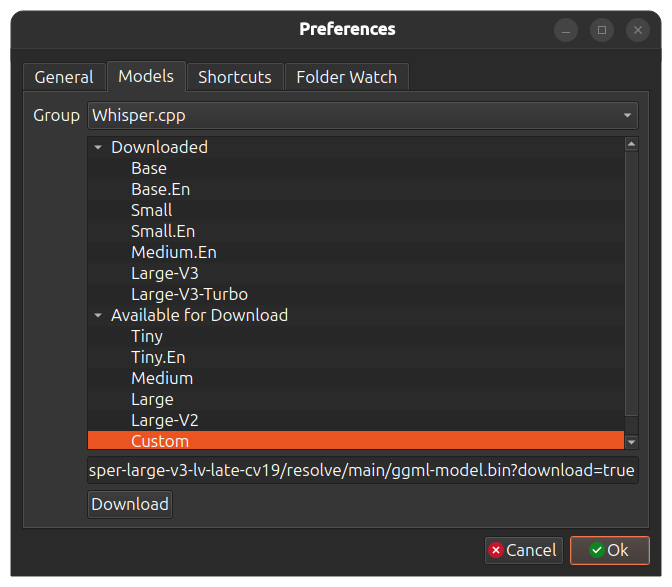
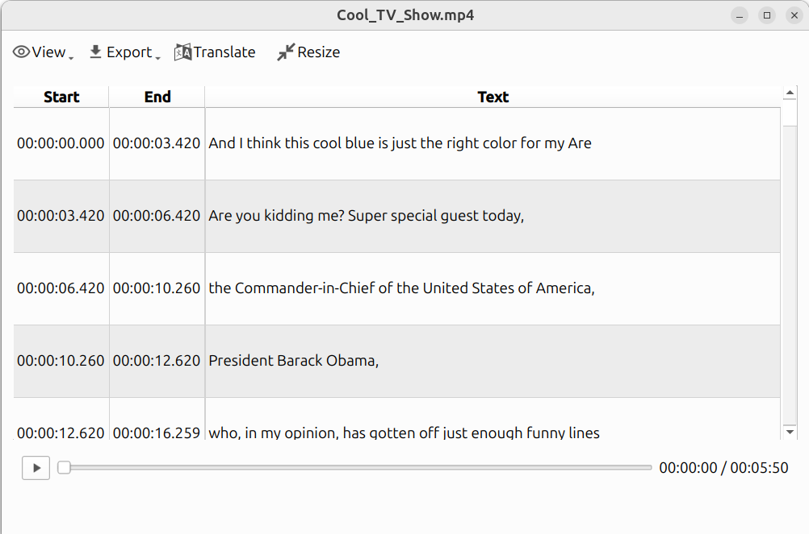
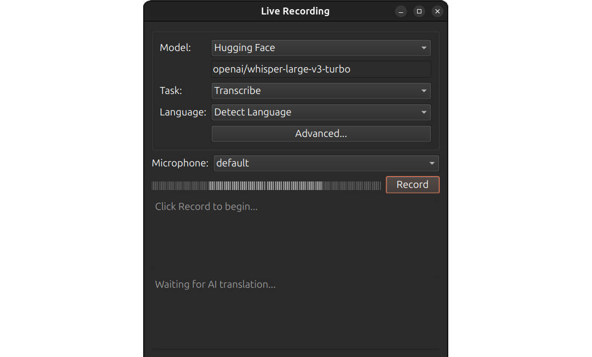
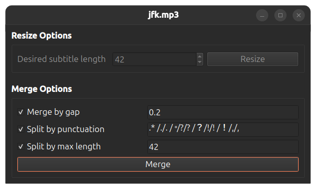

[English](README.md) · [简体中文](readme/README.zh_CN.md) · **العربية**

<div dir="rtl">

# Buzz

[التوثيق](https://chidiwilliams.github.io/buzz/)

تفريغ الصوت نصيًا وترجمته دون اتصال بالإنترنت على حاسوبك الشخصي. مدعوم بنموذج [Whisper](https://github.com/openai/whisper) من OpenAI.

</div>


[](https://github.com/chidiwilliams/buzz/actions/workflows/ci.yml)
[](https://codecov.io/github/chidiwilliams/buzz)

[](https://GitHub.com/chidiwilliams/buzz/releases/)



<div dir="rtl">

<a id="features"></a>
## الميزات
- تفريغ ملفات الصوت والفيديو أو روابط Youtube نصيًا
- تفريغ الصوت نصيًا مباشرةً وفي الوقت الفعلي من الميكروفون
  - نافذة عرض تسهّل الاطلاع على النص أثناء الفعاليات والعروض التقديمية
- فصل الكلام قبل التفريغ لتحسين الدقة في التسجيلات الصاخبة
- تحديد المتحدثين في الوسائط المفرَّغة
- دعم عدة واجهات خلفية (backends) لـ Whisper
  - دعم التسريع عبر CUDA لوحدات Nvidia GPU
  - دعم Apple Silicon لأجهزة Mac
  - دعم التسريع عبر Vulkan في Whisper.cpp على معظم وحدات GPU، بما فيها المدمجة
- دعم عدة عائلات من نماذج Transformer عبر نوع whisper في Huggingface
- تصدير النصوص المفرَّغة بصيغ TXT وSRT وVTT
- عارض نصوص متقدم يوفّر البحث وأدوات التحكم في التشغيل وضبط السرعة
- اختصارات لوحة المفاتيح لتنقّل أسرع
- مجلد مراقبة لتفريغ الملفات الجديدة تلقائيًا
- واجهة سطر الأوامر للبرمجة النصية والأتمتة
- نظام إضافات يضم إضافات مثل توليد الملخصات بالذكاء الاصطناعي وتغيير حجم النص المفرَّغ تلقائيًا

<a id="installation"></a>
## التثبيت

### macOS

نزّل ملف `.dmg` من [SourceForge](https://sourceforge.net/projects/buzz-captions/files/).

</div>

> **أجهزة Mac بمعالجات Intel:** يتطلب Buzz الآن Apple silicon. آخر إصدار يدعم
> أجهزة Mac بمعالجات Intel هو **1.4.5**.

<div dir="rtl">

### Windows

احصل على ملفات التثبيت من [SourceForge](https://sourceforge.net/projects/buzz-captions/files/).

التطبيق غير موقَّع رقميًا، لذا سيظهر لك تحذير عند تثبيته. اختر `More info` -> `Run anyway`.

### Linux

يتوفر Buzz بصيغة [Flatpak](https://flathub.org/apps/io.github.chidiwilliams.Buzz) أو [Snap](https://snapcraft.io/buzz) أو [Appimage](https://sourceforge.net/projects/buzz-captions/files/).

لتثبيت flatpak، نفّذ الأمر:

</div>

```shell
flatpak install flathub io.github.chidiwilliams.Buzz
```

[](https://flathub.org/en/apps/io.github.chidiwilliams.Buzz)

<div dir="rtl">

لتثبيت snap، نفّذ الأوامر:

</div>

```shell
sudo apt-get install libportaudio2 libcanberra-gtk-module libcanberra-gtk3-module
sudo snap install buzz
```

[](https://snapcraft.io/buzz)

<div dir="rtl">

### PyPI

ثبّت [ffmpeg](https://www.ffmpeg.org/download.html)

تأكد من استخدام بيئة Python 3.12.

ثبّت Buzz

</div>

```shell
pip install buzz-captions
python -m buzz
```

<div dir="rtl">

**دعم GPU لنسخة PyPI**

للحصول على دعم وحدات Nvidia GPU على Windows في النسخة المثبّتة من PyPI، تأكد من تثبيت نسخة [torch](https://pytorch.org/get-started/locally/) التي تدعم CUDA:

</div>

```
pip3 install -U torch==2.8.0+cu129 torchaudio==2.8.0+cu129 --index-url https://download.pytorch.org/whl/cu129
pip3 install nvidia-cublas-cu12==12.9.1.4 nvidia-cuda-cupti-cu12==12.9.79 nvidia-cuda-runtime-cu12==12.9.79 --extra-index-url https://pypi.nvidia.com
```

<div dir="rtl">

<a id="latest-development-version"></a>
### أحدث نسخة قيد التطوير

لمعرفة كيفية الحصول على أحدث نسخة قيد التطوير التي تتضمن أحدث الميزات وإصلاحات الأخطاء، راجع [الأسئلة الشائعة](https://chidiwilliams.github.io/buzz/docs/faq#9-where-can-i-get-latest-development-version).

<a id="nvidia-cuda-gpu-acceleration"></a>
### تسريع GPU عبر Nvidia CUDA

إذا كنت تستخدم Buzz بالإصدار `1.4.6` (عند صدوره) أو أحدث ولديك وحدة Nvidia GPU، فانتقل إلى `Help -> About Buzz` وثبّت CUDA Acceleration.

<a id="support-buzz"></a>
### ادعم Buzz

يمكنك دعم Buzz بوضع نجمة 🌟 للمستودع ومشاركته مع أصدقائك.

<a id="screenshots"></a>
### لقطات الشاشة

</div>

<div style="display: flex; flex-wrap: wrap;">
    
    
    
    
    
    
    
</div>

ترجمة: فريق مُشَيِّد
